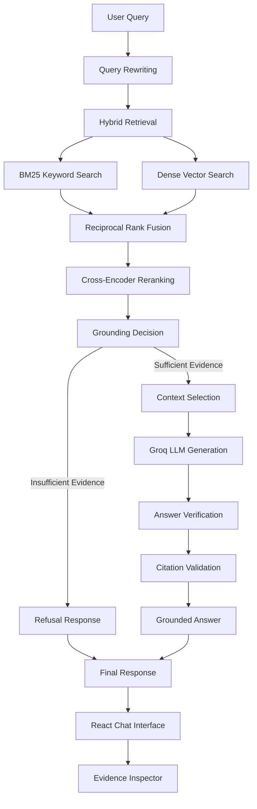

# Advanced RAG: Hybrid Retrieval & Grounded Generation

A Retrieval-Augmented Generation (RAG) system built on BBC News articles, combining keyword search, dense vector retrieval, reciprocal rank fusion, and cross-encoder reranking to produce evidence-grounded answers with source citations.

The application includes a React chat interface and an evidence inspector that exposes the retrieved sources and ranking information behind each answer.

## Demo

**[Watch the demo video](YOUR_DEMO_VIDEO_URL)**

*Demo coming soon.*

## Features

- **Hybrid retrieval:** Combines BM25 keyword search with dense vector search.
- **Reciprocal Rank Fusion:** Merges results from different retrieval methods.
- **Cross-encoder reranking:** Reorders retrieved passages by query relevance.
- **Grounded generation:** Uses retrieved evidence to answer questions and refuses unsupported queries.
- **Source citations:** Connects answers to supporting passages from the dataset.
- **Evidence inspector:** Displays source text and available retrieval rankings and scores.
- **Conversational queries:** Supports follow-up questions using conversation context.

## Architecture

### Codebase Architecture

[](https://gitdiagram.com/starryroses/groundrag-hybrid-retrieval-grounded-generation-system)

### RAG Pipeline



## Tech Stack

| Component | Technology |
|---|---|
| Backend API | Python, FastAPI |
| Frontend | React, Vite |
| Keyword retrieval | BM25 |
| Dense retrieval | Sentence Transformers, ChromaDB |
| Embedding model | `BAAI/bge-small-en-v1.5` |
| Rank fusion | Reciprocal Rank Fusion (RRF) |
| Reranking | `cross-encoder/ms-marco-MiniLM-L-6-v2` |
| LLM generation | Groq API |
| Dataset | BBC News articles |

## How It Works

1. **Ingestion:** BBC News articles are loaded and split into overlapping text chunks.
2. **Indexing:** Chunks are indexed for keyword and dense vector retrieval.
3. **Hybrid search:** BM25 retrieves lexical matches while dense search finds semantically similar passages.
4. **Rank fusion:** Reciprocal Rank Fusion combines the candidate rankings.
5. **Reranking:** A cross-encoder scores candidate passages against the query.
6. **Grounding:** The system determines whether sufficient evidence is available and selects relevant context.
7. **Generation:** The LLM generates an answer using the selected evidence.
8. **Validation:** The answer and citations are checked before the response is returned.
9. **Inspection:** The frontend lets users inspect cited evidence and available retrieval diagnostics.

## Example Usage

Ask questions about topics covered by the indexed BBC News articles, such as business, politics, technology, sport, or entertainment.

The application should provide citations when sufficient evidence is available and return the configured refusal response when the corpus cannot support an answer.

## Getting Started

### Prerequisites

- Python 3.10
- Node.js and npm
- A Groq API key
- The BBC News dataset used by the project

### 1. Clone the repository

```bash
git clone https://github.com/starryroses/GroundRAG-Hybrid-Retrieval-Grounded-Generation-System
cd rag-project
```

### 2. Set up the backend

Create and activate a virtual environment:

```powershell
python -m venv venv
.\venv\Scripts\Activate.ps1
```

Install dependencies:

```powershell
pip install -r requirements.txt
```

Create your environment file:

```powershell
Copy-Item .env.example .env
```

Add your Groq API key to `.env`, using the environment variable name expected by the application.

Start the API:

```powershell
uvicorn src.main:app --reload
```

### 3. Set up the frontend

Open a second terminal:

```powershell
cd frontend
npm install
npm run dev
```

Open the local URL displayed by Vite in your terminal.

### 4. Prepare the retrieval index

Ensure the BBC News dataset is available and the vector index has been built. Follow the project's indexing or setup scripts before sending queries to the application.

## Project Structure

```text
rag-project/
├── src/
│   ├── api/          # FastAPI routes
│   ├── app/          # Application setup and state
│   ├── generation/   # LLM generation and query rewriting
│   ├── grounding/    # Evidence grounding and citations
│   ├── ingestion/    # Dataset loading and chunking
│   ├── nlp/          # Text preprocessing
│   ├── pipeline/     # RAG pipeline orchestration
│   └── retrieval/    # BM25, dense search, RRF, reranking
├── frontend/         # React and Vite application
├── data/             # Dataset and retrieval artifacts
├── requirements.txt
├── .env.example
├── .gitignore
└── README.md
```

## Future Improvements

- Automated evaluation of retrieval relevance, answer correctness, and citation accuracy.
- Benchmarking hybrid retrieval against BM25-only and dense-only baselines.
- Improved observability and reproducible evaluation.
- Deployment with automated index preparation.

---

Built to explore hybrid information retrieval, evidence-grounded generation, and transparent RAG systems.
